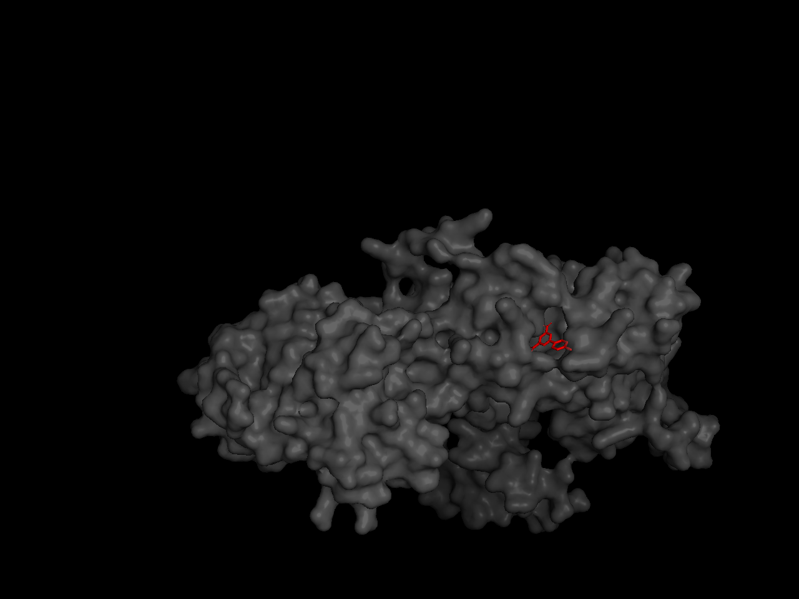
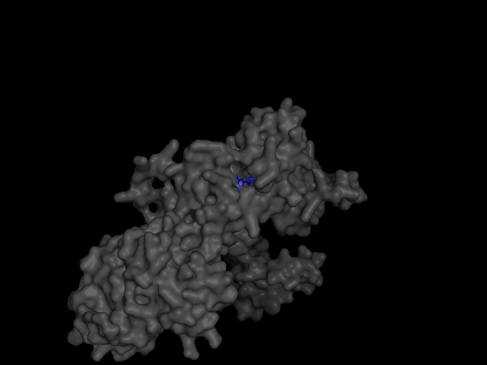
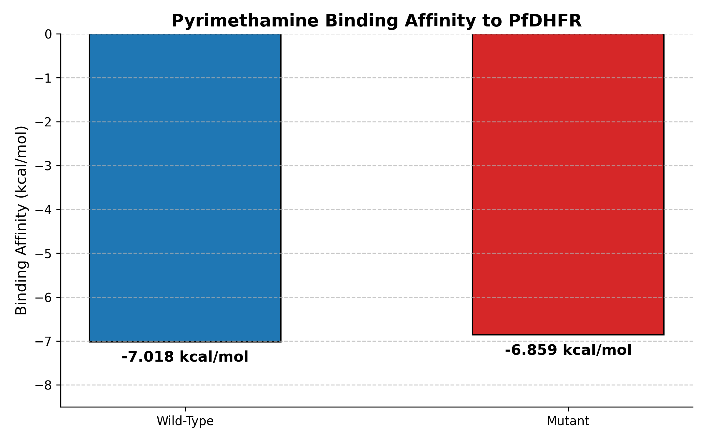
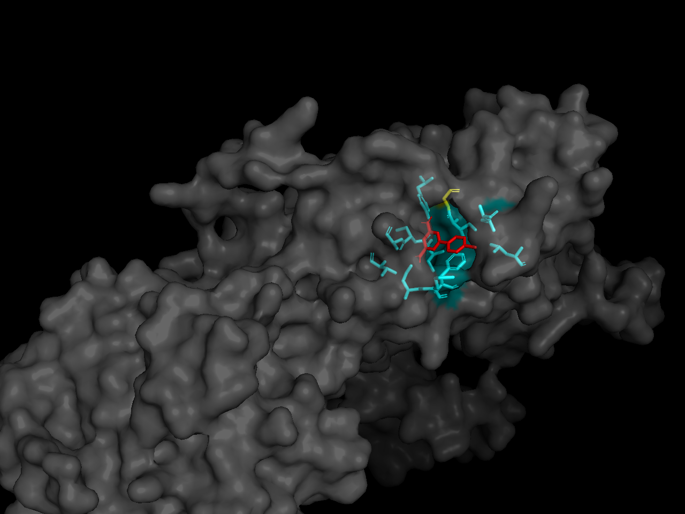
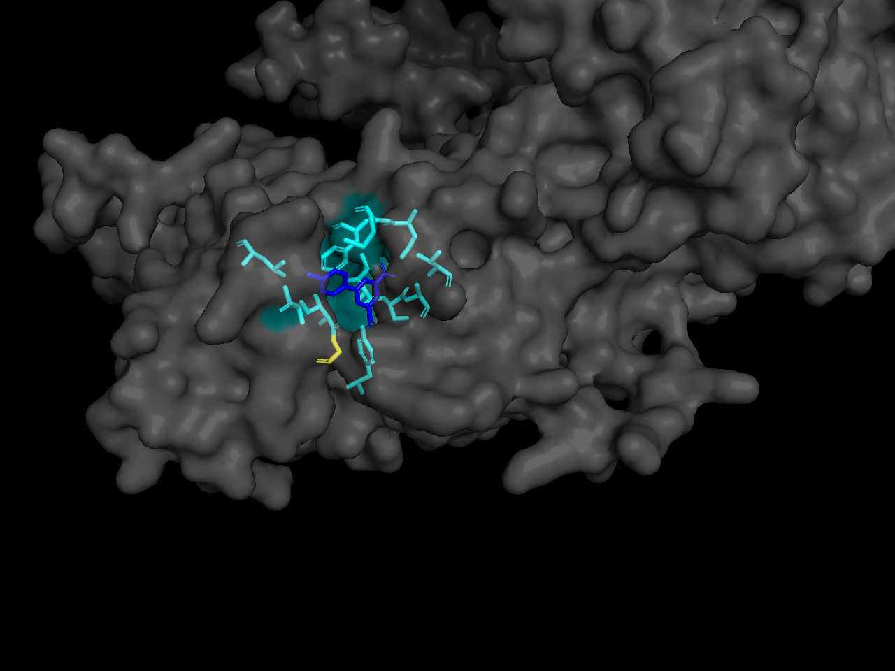

# AlphaFold 3 + AutoDock Vina: Mutation Impact on Drug Binding

https://img.shields.io/badge/Python-3.10-blue

https://img.shields.io/badge/AlphaFold-3-green

https://img.shields.io/badge/AutoDock_Vina-1.2.7-orange

## Overview
This project demonstrates a hybrid pipeline that uses **AlphaFold 3 (AF3)** for structure prediction and **AutoDock Vina** for molecular docking. It investigates how a single point mutation in the *Plasmodium falciparum* dihydrofolate reductase (PfDHFR) affects the binding of the antimalarial drug pyrimethamine.

Understanding how mutations alter drug binding is a fundamental challenge in structural biology and is directly relevant to the study of drug resistance mechanisms.

## Biological Background

**Target Protein**: Dihydrofolate reductase (DHFR) from Plasmodium falciparum, the parasite responsible for malaria.

**Ligand**: Pyrimethamine, a competitive inhibitor of DHFR used in antimalarial therapy.

**Mutation**: A known point mutation at position 108 (S108N) is associated with resistance to pyrimethamine. In this study, we modeled this mutation to observe its structural and energetic consequences.

## Tools Used
*   **AlphaFold 3**: Used to predict the 3D structures of both wild-type and mutant proteins from their amino acid sequences.
*   **AutoDock Vina v1.2.7**: Used for blind docking to calculate the binding energies (ΔG_bind) between the protein and the ligand.
*   **RDKit & Meeko**: Used for ligand preparation from SMILES strings and PDBQT conversion.
*   **PyMOL**: Used for 3D visualization of the docking results.
*   **Python 3.10 (managed via uv)**: For pipeline automation and data analysis.

## Pipeline Steps
1. **Sequence Retrieval & Mutation**: The wild-type sequence of PfDHFR was obtained from UniProt. The mutant sequence was generated by substituting the residue at position 108.

2. **Structure Prediction**: Both sequences were submitted to the AlphaFold Server to obtain 3D structures (.pdb files).

3. **Ligand Preparation**: Pyrimethamine was generated from its SMILES string using RDKit and converted to .pdbqt format with Meeko.

4. **Blind Docking**: AutoDock Vina was used with a large grid box (60x60x60 Å) centered on the protein to search the entire surface for potential binding pockets.

5. **Analysis**: The binding affinities of the top poses were compared, and the 3D binding poses were visualized in PyMOL.

## Results
The docking revealed a difference in binding affinity between the two structures:

*   **Wild-Type**: **-7.018 kcal/mol**
*   **Mutant**: **-6.859 kcal/mol**

The mutation slightly weakens the binding of pyrimethamine. This result is consistent with the hypothesis that structural changes caused by the mutation reduce the drug's ability to bind effectively to the active site.

### Visualizing the Binding Pose
The figures below show the docked ligand within the binding pocket of the wild-type and mutant proteins.

| Wild-Type (Blue Ligand) | Mutant (Red Ligand) |
| :---: | :---: |
|  |  |
| *Figure 1: Docked ligand in the WT pocket.* | *Figure 2: Docked ligand in the mutant pocket.* |

### Visualizing the Binding Pose
The bar chart below clearly illustrates the difference in binding energies between the wild-type and mutant proteins.

Figure 3: Comparison of binding affinities for pyrimethamine.

### Amino Acid Interactions (Cutoff 4.0 Å)

To understand the structural basis of the binding difference, we analyzed the protein residues within 4.0 Å of the docked ligand.

| Structure | Interacting Residues |
| :--- | :--- |
| **Wild-Type** | ALA16, ASP54, CYS15, GLY165, ILE112, ILE14, ILE164, LEU119, PHE58, THR185, TYR170 |
| **Mutant** | ALA16, ASP54, CYS15, ILE112, ILE14, ILE164, LEU119, **MET55**, PHE58, THR185, TYR170 |

**Key Observation:** 
While most of the binding pocket remains conserved, the mutation causes a subtle shift in the interaction network. Specifically, **GLY165** loses contact with the ligand in the mutant, while **MET55** becomes part of the binding site. This structural rearrangement helps explain the slight decrease in binding affinity observed in the docking results.

### 3D Visualization of Interaction Networks
The figures below show the key interacting residues (within 4.0 Å) surrounding the docked ligand. The protein surface is shown in grey, the ligand is colored (blue for WT, red for mutant), and the interacting residues are highlighted (yellow for WT, cyan for mutant).

| Wild-Type Interactions | Mutant Interactions |
| :---: | :---: |
|  |  |
| *Figure 4: Key residues (yellow) surrounding the ligand (blue).* | *Figure 5: Key residues (cyan) surrounding the ligand (red).* |

*Note: The visual comparison highlights the subtle rearrangement of the binding pocket caused by the mutation.*

### Validation of Docking Stability (RMSD)
To assess the reliability of the docking results, we analyzed the RMSD (Root Mean Square Deviation) between the top-ranked poses. A low RMSD indicates that the algorithm consistently found the same binding site.

| Structure | Mode 1 (Best) | Mode 2 | Mode 3 |
| :--- | :---: | :---: | :---: |
| **Wild-Type** | 0.00 Å | 43.00 Å | 42.80 Å |
| **Mutant** | 0.00 Å | 36.49 Å | **0.197 Å** |

**Observation:** 
The large RMSD values for Mode 2 (36–43 Å) indicate that Vina identified alternative binding sites on the protein surface during blind docking. However, for the mutant, **Mode 3** shows an RMSD of **0.197 Å**, meaning it perfectly reproduces the top binding pose. This confirms that the primary binding site is correctly identified.

## Discussion & Limitations

While this pipeline successfully demonstrates the impact of the S108N mutation, it is important to acknowledge the inherent limitations of the current approach:

* **Rigid Receptor Assumption**: AutoDock Vina treats the protein as a rigid structure. In reality, proteins are dynamic, and mutations can cause conformational changes (induced fit) that alter the binding pocket's shape beyond what is captured in a single static structure.
* **AlphaFold 3 Limitations**: AF3 predicts a static, high-confidence structure. However, it does not account for protein dynamics, allosteric effects, or post-translational modifications that may occur in a biological system.
* **Blind Docking Constraints**: While blind docking explores the entire protein surface, it may identify alternative binding sites with lower affinities (as seen in the RMSD analysis). Further refinement with a focused grid box on the known active site is recommended for precise ΔG calculations.

## Future Directions
This project serves as a foundational framework. Future iterations could be significantly enhanced by:
1.  **Molecular Dynamics (MD) Simulations:** Using tools like GROMACS to simulate the protein-ligand complex over time to validate the stability of the docked poses and observe the dynamic effects of the mutation.
2.  **Integration of Protein Language Models (PLMs):** Utilizing models like ESM or Tranception to predict the pathogenicity of mutations *in silico* before running computationally expensive docking simulations. This aligns with modern approaches in computational biology that bridge sequence-based ML with structural biophysics.
3.  **Ensemble Docking:** Docking the ligand against multiple conformational states of the protein (e.g., generated via MD) to better capture the flexibility of the binding pocket.

## References
1.  **AlphaFold 3:** Abramson, J., et al. (2024). Accurate structure prediction of biomolecular interactions with AlphaFold 3. *Nature*.
2.  **AutoDock Vina:** Eberhardt, J., et al. (2021). AutoDock Vina 1.2.0: New Docking Methods, Expanded Force Field, and Python Bindings. *Journal of Chemical Information and Modeling*.
3.  **PfDHFR Mutation:** Sirawaraporn, W., et al. (1997). Mutational analysis of the dihydrofolate reductase from *Plasmodium falciparum*. *Journal of Biological Chemistry*.

### Evolutionary Scoring vs. Biophysical Docking
To further investigate the mutation's impact, we used the **ESM-2 protein language model** (Meta AI) to score the evolutionary fitness of the S108N mutation. Using a masked marginal approach, we calculated the log-likelihood ratio (LLR) between the wild-type and mutant residues.

*   **ESM-2 Result**: The LLR score was positive (+1.2490), indicating that the mutation is **evolutionarily tolerated** (the protein can still fold and function).
*   **Docking Result**: In contrast, AutoDock Vina showed that the mutation slightly **weakens drug binding** (ΔG decreased by 0.159 kcal/mol).

**Key Insight**: These results highlight the complementary nature of sequence-based and structure-based approaches. While ESM-2 suggests that the mutation is evolutionarily tolerated (it does not severely disrupt the protein's evolutionary fitness), AutoDock Vina reveals that the mutation introduces subtle energetic penalties in the binding pocket. This discrepancy underscores that evolutionary models (pLMs) and physical docking capture different aspects of protein biology. Integrating both approaches is essential to fully understand the mechanistic consequences of missense variants.

## How to Reproduce

To run this pipeline on your local machine and reproduce the results, follow the step-by-step instructions below:

### 1. Clone the Repository
First, clone the project to your local machine and navigate into the project directory:
```bash
git clone https://github.com/whiteeelola/af3-vina-mutation.git
cd af3-vina-mutation
```

### 2. Set Up the Virtual Environment
This project uses Python 3.10 and uv for fast and reproducible package management. Create and activate a virtual environment:
```
uv venv --python 3.10
source .venv/bin/activate  # On Windows, use: .venv\Scripts\activate
```
### 3.Install Dependencies
Install all required Python packages, including RDKit, Meeko, Biopython, and Matplotlib:
```
uv pip install rdkit meeko numpy matplotlib biopython
```

### 4. Prepare the Vina Executable
The AutoDock Vina executable is not included in this repository due to size limits. You must download it manually:

1. Go to the official [AutoDock Vina GitHub Releases page](https://github.com/ccsb-scripps/AutoDock-Vina/releases).
2. Download the Windows version (e.g., vina_1.2.7_win.exe).
3. Rename the downloaded file to vina.exe.
4. Place vina.exe directly in the root directory of this project.

### 5.Run the Pipeline
The pipeline consists of four main scripts that should be run in the following order:

| Step | Script Name | 	Description|
| :--- | :---: | :---: |
| 1 | docking.py | Prepares the ligand, cleans the receptors, and runs AutoDock Vina for both wild-type and mutant proteins. |
| 2 | plot_results.py | 	Parses the docking logs and generates a bar chart comparing binding affinities. |
|3 | analyze_contacts.py| Identifies the amino acid residues within 4.0 Å of the docked ligand. |
| 4 | analyze_rmsd.py | Validates the stability of the docking poses by analyzing the RMSD values. |

### Expected output
After running all scripts, the following files will be generated in the project root and the results/ directory:

* wild_type_docked.pdbqt and mutant_docked.pdbqt (docking poses)

* binding_affinity_chart.png (bar chart)

* Terminal outputs showing interacting residues and RMSD values.

Note: The 3D visualization images (wild_type_docking.png, mutant_docking.png, wild_type_interactions.png, mutant_interactions.png) were generated using PyMOL and are already included in this repository.